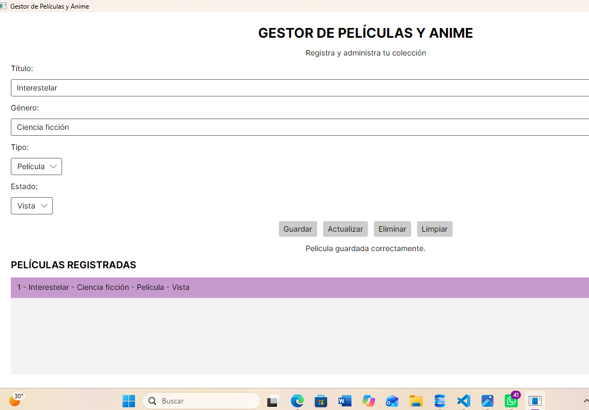
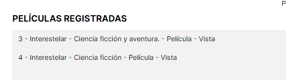
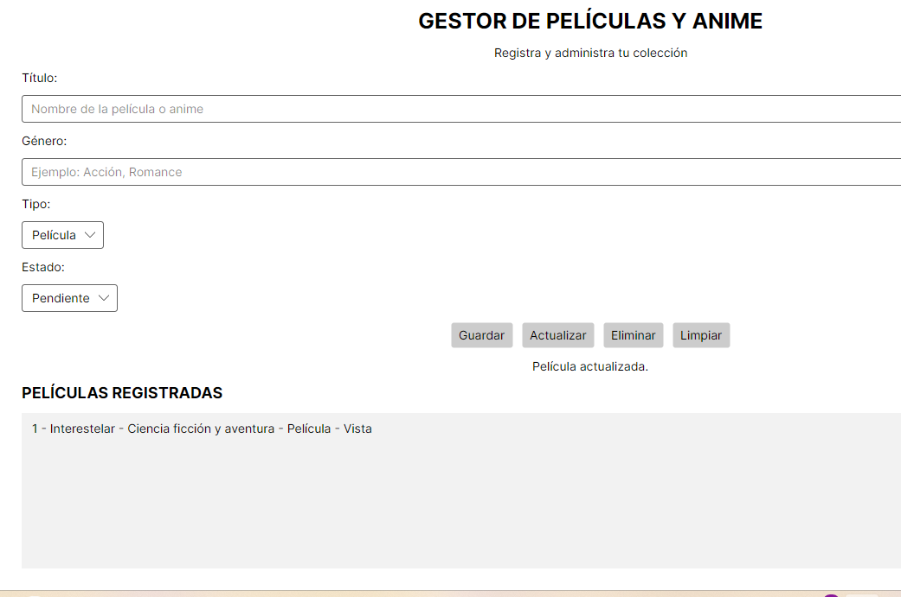
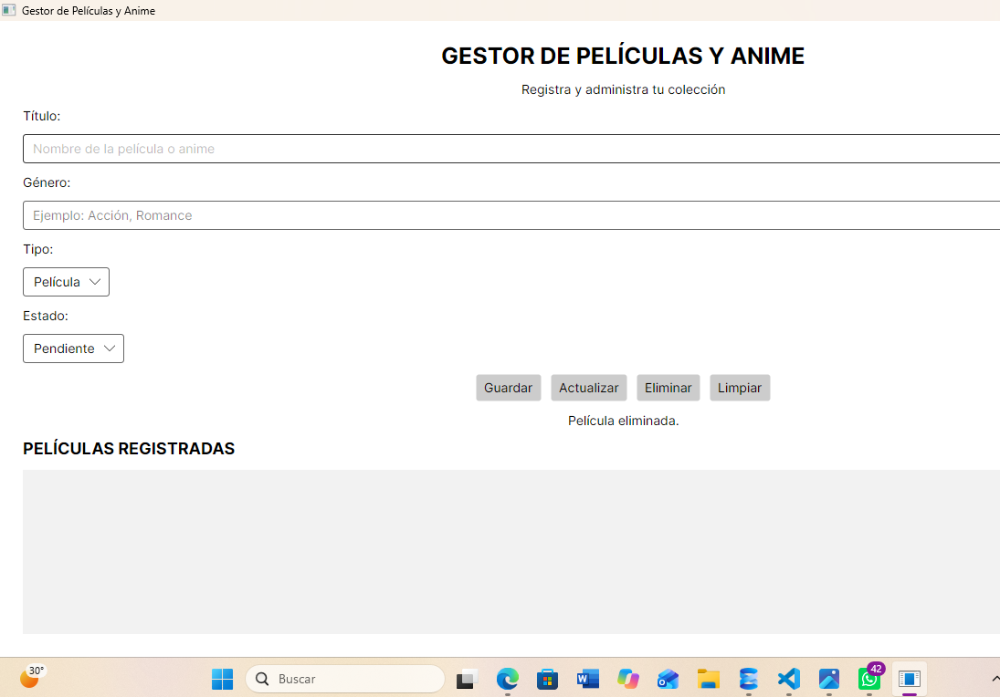
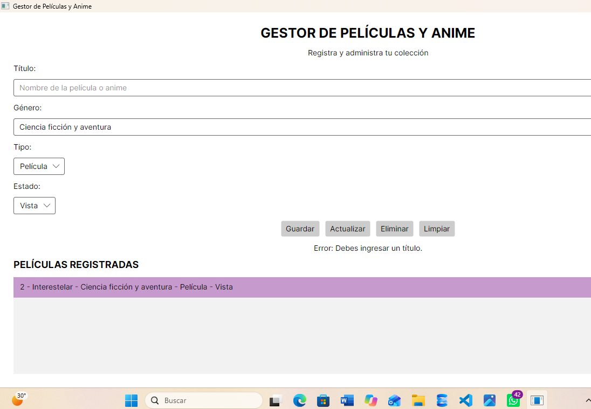
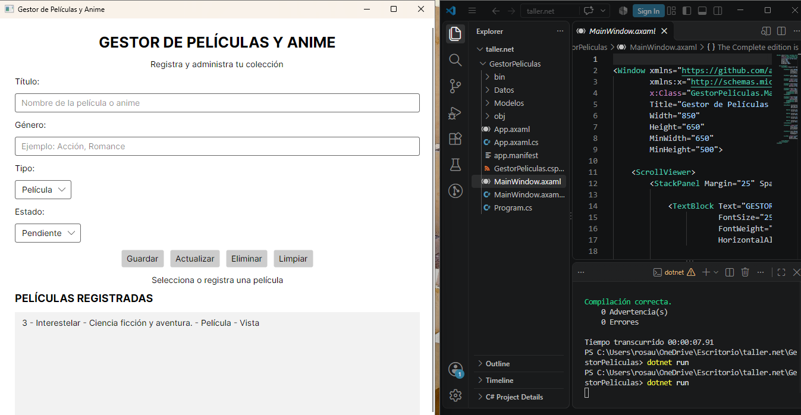

# Gestor de Películas y Anime

## 1. Información general

**Estudiante:** Robyelit Rodríguez Ávila  
**Asignatura:** Programación con C# y .NET  
**Universidad:** Corporación Universitaria Americana

### Descripción

Este proyecto consiste en una aplicación de escritorio que permite registrar y organizar películas y animes. Fue desarrollado utilizando C#, .NET, Avalonia UI y SQLite.

### Problema que resuelve

Muchas veces queremos llevar un registro de las películas y animes que hemos visto o tenemos pendientes. Esta aplicación permite organizar esa información de manera sencilla.

### Objetivo

Desarrollar una aplicación que permita guardar, consultar, actualizar y eliminar películas y animes utilizando una interfaz gráfica y una base de datos.

## 2. Funcionalidades

La aplicación permite realizar las siguientes operaciones:

- **Registrar:** agregar películas y animes con su título, género, tipo y estado.
- **Consultar:** visualizar los registros guardados.
- **Actualizar:** modificar la información de un registro.
- **Eliminar:** borrar una película o anime.
- **Validar:** evitar que se guarden registros sin título o género.
- **Persistencia:** conservar los datos después de cerrar la aplicación.

## 3. Tecnologías utilizadas

- C#
- .NET 8
- Avalonia UI 11.3.12
- ADO.NET
- SQLite
- Microsoft.Data.Sqlite 8.0.11
- Visual Studio Code

## 4. Estructura del proyecto

```text
GestorPeliculas/
├── Datos/
│   └── PeliculaDAO.cs
├── Modelos/
│   └── Pelicula.cs
├── evidencias/
│   ├── 01_registrar.png
│   ├── 02_consultar.png
│   ├── 03_actualizar.png
│   ├── 04_eliminar.png
│   ├── 05_validacion.png
│   └── 06_persistencia.png
├── App.axaml
├── App.axaml.cs
├── MainWindow.axaml
├── MainWindow.axaml.cs
├── Program.cs
├── GestorPeliculas.csproj
└── README.md
```

### Programación Orientada a Objetos

En el proyecto se aplican conceptos de POO mediante las siguientes clases:

- **Pelicula:** representa los datos de cada película o anime. Contiene propiedades, un constructor y un método para mostrar información.
- **PeliculaDAO:** se encarga de realizar las operaciones con la base de datos.
- **MainWindow:** controla la interacción del usuario con la interfaz gráfica.

De esta manera se separa la información, el acceso a datos y la interfaz.

## 5. Instalación de dependencias

Para ejecutar el proyecto se necesita tener instalado el SDK de .NET 8.

Primero se debe descargar o clonar el repositorio de GitHub:

```bash
git clone URL_DEL_REPOSITORIO
```

Después se ingresa a la carpeta del proyecto:

```bash
cd GestorPeliculas
```

Se restauran las dependencias:

```bash
dotnet restore
```

Los paquetes utilizados se encuentran declarados en el archivo `GestorPeliculas.csproj`.

## 6. Ejecución

Para compilar el proyecto:

```bash
dotnet build
```

Para ejecutar la aplicación:

```bash
dotnet run
```

Al iniciar, se abre una ventana donde se pueden registrar y administrar las películas y animes.

## 7. Base de datos

La aplicación utiliza SQLite para almacenar la información.

La base de datos se llama `peliculas.db` y se crea automáticamente cuando se inicializa la clase `PeliculaDAO`.

### Tabla Peliculas

| Campo | Descripción |
|---|---|
| Id | Identificador único |
| Titulo | Nombre de la película o anime |
| Genero | Género del contenido |
| Tipo | Película o anime |
| Estado | Vista o pendiente |

La conexión se realiza mediante `Microsoft.Data.Sqlite`, utilizando ADO.NET.

Las operaciones SQL se encuentran en `PeliculaDAO.cs` y utilizan parámetros para incorporar los datos del usuario.

## 8. Evidencias de funcionamiento

### Registro



Se comprueba que es posible registrar una película y visualizarla en la lista.

### Consulta



Se muestran los registros almacenados en la base de datos.

### Actualización



Se modifica la información de una película y se comprueba que los cambios aparecen en la lista.

### Eliminación



Se elimina un registro y se verifica que desaparece de la lista.

### Validación



Se intenta guardar información incompleta y la aplicación muestra un mensaje de error.

### Persistencia



Se cierra y se vuelve a abrir el programa para comprobar que los registros continúan guardados.

## 9. Problemas encontrados y soluciones

Durante el desarrollo se presentaron algunos errores de compilación relacionados con las versiones de Avalonia UI y .NET.

Para solucionarlos se utilizó una versión de Avalonia compatible con .NET 8 y se corrigió la configuración del proyecto.

También se presentaron errores al conectar los eventos de la interfaz gráfica con los métodos de C#. Estos se solucionaron creando los métodos correspondientes en `MainWindow.axaml.cs`.

Finalmente, se logró ejecutar la aplicación y conectar sus funcionalidades con la base de datos SQLite.

## 10. Conclusión

Con este proyecto pude poner en práctica los conocimientos adquiridos durante el curso, especialmente la Programación Orientada a Objetos, el desarrollo de interfaces gráficas con Avalonia UI y el manejo de bases de datos mediante ADO.NET.

Aprendí cómo conectar los botones de una aplicación con operaciones que permiten guardar, consultar, modificar y eliminar información.